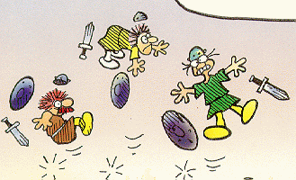
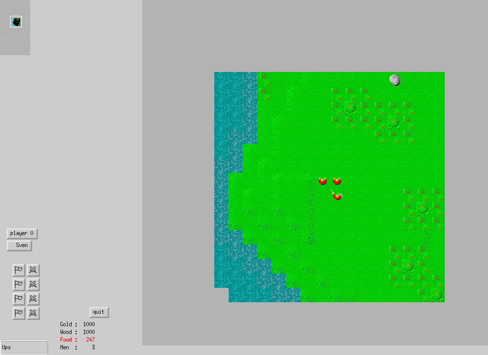
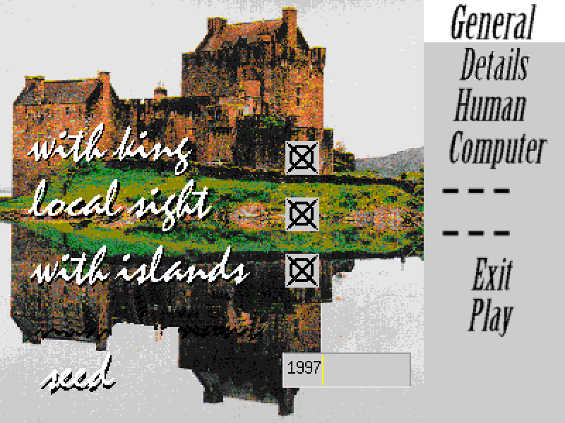
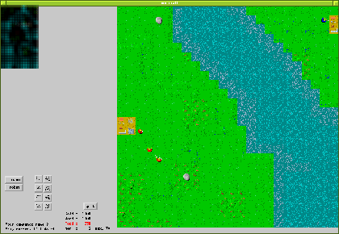

# xcraft-sdl

<p align="center"></p>

**CRAFT 3.5** is a real-time strategy game written for X11 by Uwe Beyer
at GMD (the German National Research Center for Information Technology)
in 1993–1997. You start on a random island world with a king (a knight),
two workers and a few resources. You build town halls, farms, markets and
docks, harvest wood and gold, train an army, sail ships and fight the
computer players.

This repository ports CRAFT to **SDL2**. It runs natively on Wayland (and
anywhere else SDL2 runs) without an X server, and its 1990s C++ builds with
a current compiler. The game itself is unchanged.



*A worker starts a town hall, another worker walks to the forest and the king
explores the coast. Recorded on Wayland at speed 1x (seed 1997).*

## Running it

### NixOS / Nix

```sh
git clone https://github.com/rpmcruz/xcraft-sdl.git
cd xcraft-sdl
nix-shell --run make      # shell.nix provides g++, make, pkg-config and SDL2
./xcraft
```

### Other Linux distributions

Install a C++ compiler, `make`, `pkg-config` and the SDL2 development
package, then build:

```sh
sudo apt install g++ make pkg-config libsdl2-dev   # Debian/Ubuntu
sudo dnf install gcc-c++ make pkgconf SDL2-devel    # Fedora
make
./xcraft
```

`xcraft` finds its data (`data/`) next to the executable, so you can start it
from anywhere. To keep the data somewhere else, set `XCRAFT_DATA=/path/to/data`.

On a Wayland desktop SDL uses its Wayland driver. X11 is only a fallback for
systems without Wayland. You can force a driver with
`SDL_VIDEODRIVER=wayland` or `SDL_VIDEODRIVER=x11`.

## Playing

<p align="center"></p>

The option screen comes first:

* **General**: play with a king (lose him and you lose), local sight (fog
  of war), islands, and a **seed** for the random world. The same seed gives
  the same map.
* **Details**: world size and unit speed (how many game cycles a unit needs
  for each step).
* **Human / Computer**: player names and the strength and aggressiveness of
  the computer players.
* **Play** starts the game and **Exit** quits.

In the game:

| Input | Action |
| --- | --- |
| Left click on a unit | select it; its orders appear in the panel |
| Left click on an order, then on the map | give the order (move, dig, build a town hall, attack, ...) |
| Middle click, or Shift/Ctrl + left click | add a unit to the selection |
| Right click on the map | centre the view there; cancels an order that is waiting for its target |
| Click on the mini map (top left) | jump there |
| Letter keys (pointer over the map) | the capital letter of an order, e.g. `A` for tr**A**p |
| `1`–`4` / `5`–`8` (or the flag / sword buttons) | store / recall unit groups |
| your **player** button (left side) | pause / resume |
| **speed** slider (above **quit**) | game speed, from 1/2x to 64x, and **max**; change it at any time |
| `F11` or `Alt+Enter` | toggle fullscreen |

The game starts at speed 4x. Speed 1x is the pace CRAFT was written for, 20
game cycles per second. On a modern computer that feels slow, so pick
whatever suits you. **max** does not wait at all, which is far too fast to
play.

You can resize or maximise the window and the game is stretched to fill it,
with no black bars. The initial window size is the largest whole-number scale
that fits your screen. `XCRAFT_SCALE=2 ./xcraft` picks a scale yourself.

For comparison, this is CRAFT on X11 in the 1990s, from the original web page:

<p align="center"></p>

## How the port works

CRAFT talks to X11 almost exclusively through one class, `win` (in the
original `win.hc`). The port replaces that class and leaves the game logic
alone:

* **`src/win.cc`** implements `win` on SDL2. Every former X window (the main
  window, the map, the status panel, dialogs, menus) is now a software canvas,
  and all of them are composited into **one** SDL window, shown in a single
  update per frame.
  Drawing follows the X11 rules the game relies on: GC raster functions such
  as XOR, clip rectangles and clip masks, `XCopyPlane` for bitmaps, and
  image text.
  Input goes to the window under the pointer, with an implicit grab while a
  button is held, as in X.
* Text uses the original **misc-fixed** X fonts (6x13 and 5x8), and the
  pointer uses the original **X cursor-font** shapes (arrow, circle, man,
  crosshair, watch). Both are embedded as data generated by `tools/bdf2c.py`
  and `tools/cursor2c.py`, so no font or X library is needed at runtime.
* The colours are the X11 `rgb.txt` values of the 63 named colours CRAFT
  allocates.
* **Speed:** the main loop was written for a game cycle of at least 50 ms
  (`min_cycle_time` in `craft.hc`), that is at most 20 cycles per second. The
  original `delay()` slept `dt*10` microseconds instead of `dt` milliseconds,
  so that limit was never enforced: on a 2026 PC the original runs about
  1,700 cycles per second. The port paces the cycles by the **speed** slider
  instead. Speed 1x is the 50 ms cycle, and **max** does not wait.
* The sources are written in "hierarchical C++": named refinements
  (`. name { ... }.`) inside functions. The original preprocessor `hcc` (in
  `tools/hcc`) expands them to plain C++ under `build/gen` before compiling.

Fixes needed for a modern compiler and C library:

* `bool` was `#define`d as `int`. It is now the C++ type, and the few places
  that relied on it being an `int` were fixed.
* The `getline` class clashes with POSIX `getline()` and was renamed
  `getline_field`.
* Several functions could end without returning a value. GCC now turns that
  into a crash; they return a value now.
* `hcc` crashed for the same reason.
* The computer players' ship code read a table (`s_dest` in `robot.hc`)
  before storing anything in it. That was harmless while fresh memory was
  zero, but with reused memory it crashed after a few minutes of play. The
  tables are now cleared when a computer player is created.
* `ftime()` was replaced with `gettimeofday()`.

Every changed file starts with a dated note saying what was changed, as the
CRAFT license asks.

### Layout

```
src/          game sources (.hc/.h) and the SDL back end win.cc
tools/hcc/    the refinement preprocessor hcc (with its documentation)
tools/*.py    generators for src/fixedfont_data.h and src/xcursors_data.h
tools/headless/  runs xcraft in a headless Wayland compositor (sway) and drives
              it; record-demo.sh made docs/gameplay.gif
data/         runtime data: hcraft/ (units, maps, menus), buttons/, .windefaults.params
docs/         images for this README, README.original (the 1997 README)
```

## Limitations

* Only one human player per computer. CRAFT could put each human player on
  a different X display (the **Host** field in the *Human* menu). With a
  single SDL window that is not possible, so the field is ignored. Play
  against the computer.
* The map editors that ship with the CRAFT sources (`cmedit`, `hmedit`, ...)
  are not ported. Only the game is built.
* There is no sound; the original game build had none either.

## Credits and license

CRAFT is © Uwe Beyer, GMD, 1993–1997. hcc is by Uwe Beyer and Smieja, also
at GMD.
Original page:
<https://web.archive.org/web/20030324085855/http://borneo.gmd.de/AS/janus/craft/craftcc35.html>.
The original sources are `craftcc35.tar.Z`, mirrored at
<https://ibiblio.org/pub/linux/games/strategy/craftcc35.tar.Z>.

The CRAFT license allows modified versions provided that the changes are
marked in each file and made freely available. See [LICENSE](LICENSE). The
misc-fixed fonts are in the public domain, and the X cursor glyphs are
"unencumbered".
